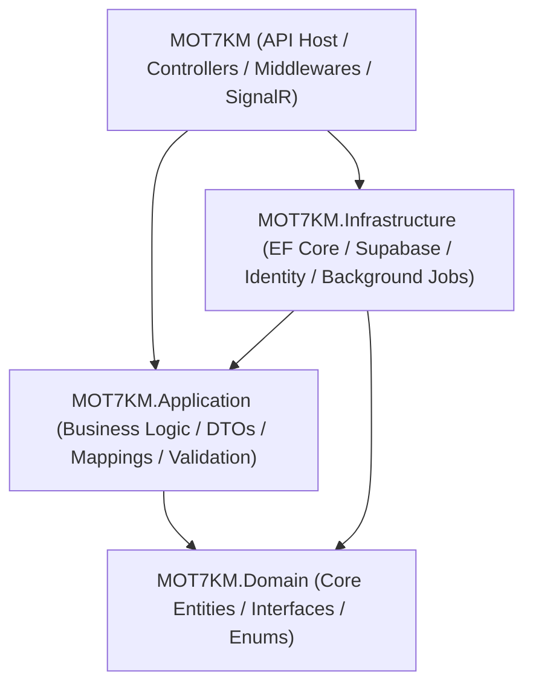

# **🚀 MOT7KM (مُتحكِّم) - تقرير المشروع والإنجازات الحالية وخارطة الطريق**

---

## **🎯 نظرة عامة على المشروع (Project Overview)**

**MOT7KM (مُتحكِّم)** هو نظام متكامل من فئة **Multi-Tenant SaaS ERP & Digital Interactive Menu Platform Backend**، مبني بأحدث تقنيات **.NET 10 (C# 13/14 preview)** وقاعدة بيانات **PostgreSQL** عبر **Supabase**.

يهدف المشروع إلى تمكين أصحاب المطاعم، المقاهي، والأنشطة التجارية من إدارة أعمالهم بدقة وكفاءة عبر:
1. **التحكم الشامل في الهوية الرقمية**: الفروع، ساعات العمل، ألوان الهوية البصرية، والخطوط الطباعية.
2. **إدارة قوائم الطعام (Menu Engine)**: إنشاء وتعديل القوائم، الأقسام، المنتجات، المكونات، شارات الحساسية، والخيارات الإضافية.
3. **التسويق والتفاعل**: بنرات ترويجية تفاعلية (Carousels) مع تحكم كامل بالتصميم، ونظام تقييمات مخصص للمنتجات.
4. **منيو رقمي فائق السرعة للزبائن (Public Web Menu)**: مصمم لمسح الـ QR Code وتقديم بيانات المتجر كاملة في طلب واحد فائق السرعة (< 100ms).
5. **لوحة تحكم وتحليلات ذكية (Admin Dashboard & Analytics)**: مراقبة مباشرة لزيارات الـ QR، أداء الفروع، حركة الطلبات، رؤى ذكاء اصطناعي (AI Insights)، وتحديثات فورية عبر SignalR.

---

## **🏛 المعمارية البرمجية (Current Architecture)**

تمت إعادة هيكلة المشروع مؤخراً بنجاح إلى معمارية **Clean Architecture + Modular Monolith** لضمان قابلية التوسع والصيانة:

---

## **🏆 ما تم إنجازه حتى الآن (What Has Been Achieved)**

### **1. إعادة الهيكلة البرمجية (Clean Architecture Migration)**
- فصل النظام إلى 4 مشاريع أساسية:
  - `MOT7KM.Domain`: الكيانات الأساسية وقواعد الدومين المستقلة تماماً.
  - `MOT7KM.Application`: منطق الأعمال، الـ DTOs، المابينج اليدوي السريع (Extension Methods)، وقواعد التحقق (FluentValidation).
  - `MOT7KM.Infrastructure`: التعامل مع قاعدة البيانات (EF Core Migrations)، الجلسات والتشفير، والمخدمات الخارجية كـ Supabase.
  - `MOT7KM` (API Host): نقاط النهاية (Controllers)، الـ Middlewares، إعدادات Kestrel و Swagger.
- بناء نظيف ومستقر 100% بنتيجة: **`0 Warnings, 0 Errors`**.

---

### **2. الأمان ونظام الجلسات المتقدم (Security & Hybrid Identity Engine)**
- **المصادقة الهجينة (Hybrid Auth)**:
  - دعم Supabase GoTrue لتسجيل الدخول بـ (Google OAuth, Facebook, و Phone SMS OTP).
  - دعم التسجيل والتوثيق المحلي لأصحاب الأعمال (`BusinessOwner`) والمسؤولين (`SuperAdmin`).
- **نظام الجلسات الانزلاقية (Sliding Session & Token Rotation)**:
  - **Access Token**: صالح لمدة 15 دقيقة فقط (`expiresIn: 900s`) مع إدراج Claims التينانت ونوع المستخدم.
  - **Refresh Token**: صالح لمدة 30 يوماً يتجدد تلقائياً مع كل استدعاء (Sliding Expiration)، مما يمنع تسجيل خروج المستخدم طالما التطبيق نشط.
  - **كشف إعادة الاستخدام وتشفير التوكنات (Family Reuse Detection)**: تخزين هاش الـ Tokens عبر خوارزمية `SHA-256`، وإلغاء صلاحية عائلة الجلسة بالكامل فور رصد أي محاولة تكرار أو اختراق.
- **عزل التينانت وحماية الملكية (Multi-Tenancy & IDOR Prevention)**:
  - تطبيق واجهة `IMustHaveTenant` لجميع الكيانات التابعة للأنشطة.
  - خدمة `OwnershipAuthorizationService` للتحقق التلقائي من أن صاحب النشاط لا يمكنه قراءة أو تعديل بيانات نشاط آخر.

---

### **3. موديول الملف التجاري والهوية البصرية (Business Profile & Branding)**
- إدارة بيانات المتجر الأساسية وروابط التواصل (واتساب، انستجرام، فيسبوك).
- **الهوية البصرية (Visual Identity)**:
  - الألوان: اللون الأساسي واللون الثانوي بصيغة HEX (`#HEX`).
  - الخطوط (Typography): دعم خطوط Google Fonts للغتين العربية والإنجليزية.
  - نمط العرض (Theme Mode): الفاتح، الداكن، أو التلقائي.

---

### **4. موديول الفروع المتقدم ومواعيد العمل (Business Branches Module)**
- إدارة متعددة للفروع (`BusinessBranch`) مع تحديد الفرع الرئيسي (`IsMainBranch`).
- العناوين التفصيلية (`BranchAddress`): الشارع، المدينة، المحافظة، الدولة، العنوان المنسق الكامل، ورابط خرائط جوجل (`MapsUrl`).
- مواعيد العمل لكل فرع (`BranchWorkingHours` و `BranchWorkingHoursDay`):
  - تحديد أوقات الفتح والإغلاق لكل يوم من أيام الأسبوع.
  - تبديل حالة الإغلاق المؤقت للفرع بنقرة واحدة (`is-closed`).

---

### **5. محرك القوائم والمنتجات (Menus & Products Catalog Engine)**
- التسلسل الهيكلي الكامل: القائمة (`Menu`) ➔ الأقسام (`Categories`) ➔ المنتجات (`Products`).
- تفاصيل المنتجات المتقدمة:
  - المكونات (`ProductIngredient`).
  - خيارات التخصيص والإضافات (`ProductCustomization`).
  - شارات التنبيه ومسببات الحساسية (Allergen Badges).
  - مفتاح التوفر الفوري (`IsAvailable`).
- موديول التقييمات والمراجعات (`Reviews`):
  - تسجيل تقييمات العملاء من 1 إلى 5 مع التعليقات.
  - واجهات خاصة للتاجر للتحكم في ظهور المراجعة والرد عليها (`MerchantReviewService`).

---

### **6. نظام البنرات الترويجية (Promotional Carousel Module)**
- مجموعات السلايدر المرتبطة بالقوائم.
- تخصيص الشرائح الإعلانية: العنوان، الوصف، الصورة، الرابط، وتخصيص لون الخلفية (`BackgroundColor`) للعرض المتناسق مع الهوية.

---

### **7. لوحة التحكم المتقدمة للأدمن (Admin Dashboard Overview - أحدث إنجاز)**
تم تضمين سيرفيس متكاملة ومحكمة (`AdminDashboardOverviewService` - أكثر من 600 سطر برمجي):
- **الهيدر والبيانات اللحظية**: دروب داون الفروع، وحساب الطلبات النشطة في المطبخ لحظياً (`orders/active-count`).
- **المؤشرات والرسوم البيانية**: إحصائيات الـ QR Views، المنتجات، المبيعات، ومقارنة أداء الفروع أسبوعياً.
- **الأقسام والمنتجات الأكثر شعبية**: قائمة الأطباق الأكثر مشاهدة وتوزيع المبيعات حسب القسم مع نسب مئوية.
- **رؤى الذكاء الاصطناعي (AI Insights & Promotions)**: توصيات ذكية تلقائية بحسب سلوك المستهلك وزيارات الفروع، مع إمكانية تفعيل العروض الترويجية المقترحة مباشرة.
- **سجلات النظام وملاحظات العملاء (Feedback & System Logs)**: استعراض مباشر لآخر المراجعات وتتبع العمليات المنفذة في النظام.

---

### **8. منيو الويب العام فائق السرعة (Customer Public Menu API)**
- نقطة نهاية عامة `GET /api/menu/by-business-name/{businessName}`:
  - لا تتطلب مصادقة (`[AllowAnonymous]`).
  - تُرجع شجرة البيانات بالكامل (بيانات المتجر، الهوية البصرية، الفروع، السلايدر، الأقسام، والمنتجات) في رد واحد مجمع لتوفير سرعة فائقة للزبون عند مسح الـ QR.

---

### **9. الأداء المرتفع ومعالجة الدفعات (High-Throughput Batch Processing)**
- معالجة عدادات الزيارات للمنتجات عبر طابور ذاكرة غير متزامن (`IProductViewQueue` + `ProductViewBatchWorker`):
  - تجميع الزيارات في الذاكرة وكتابتها في دفعات كل 5 ثوانٍ أو كل 100 زيارة.
  - يمنع الضغط أو الاختناق على قاعدة بيانات PostgreSQL عند أوقات الذروة.
- تحديثات فورية للمؤشرات عبر **SignalR Hub** (`/hubs/dashboard`).

---

### **10. التشغيل السحابي وخط الإنتاج (DevOps & CI/CD)**
- مسار نشر آلي عبر **GitHub Actions** (`deploy.yml`) يستهدف سيرفرات **MonsterASP (IIS Windows x86)** عند الـ Push على الفروع الرئيسية.
- آلية ذكية لتجنب إغلاق الملفات (File Locking) عن طريق رفع `app_offline.htm` تلقائياً عبر FTP وإزالتها فور انتهاء النشر.
- ملفات Postman كاملة لاختبار كافة واجهات وبروتوكولات النظام.

---

## **📋 حالة واجهات الـ API المنفذة حالياً**

| الموديول / النطاق | المسار الأساسي | الفئة المستهدفة | الحالة |
| :--- | :--- | :--- | :--- |
| **Admin Dashboard** | `/api/AdminDashboard/*` | المسؤولين والمديرين | ✅ مكتمل وجاهز |
| **Super Admin Auth** | `/api/Admin/SuperAdmin/*` | إدارة المنصة العليا | ✅ مكتمل وجاهز |
| **Audit Logs** | `/api/Admin/AuditLogs/*` | سجلات الأمان والعمليات | ✅ مكتمل وجاهز |
| **Mobile Auth & Tokens** | `/api/mobile/Auth/*` | أصحاب الأعمال (موبايل) | ✅ مكتمل وجاهز |
| **Branches & Addresses** | `/api/BusinessBranch` & `/api/mobile/branch` | إدارة الفروع والعناوين | ✅ مكتمل وجاهز |
| **Mobile Menu Engine** | `/api/mobile/menu/*` | إدارة القوائم والمنتجات | ✅ مكتمل وجاهز |
| **Product Details** | `/api/mobile/menu/Product*` | المكونات والتخصيصات | ✅ مكتمل وجاهز |
| **Business Profile** | `/api/mobile/Profile/*` | الهوية البصرية والألوان | ✅ مكتمل وجاهز |
| **Promotions / Carousel** | `/api/mobile/Carousel/*` | سلايدر الإعلانات والعروض | ✅ مكتمل وجاهز |
| **Reviews & Feedback** | `/api/mobile/Reviews/*` | إدارة مراجعات وتقييمات العملاء | ✅ مكتمل وجاهز |
| **Public Web Menu** | `/api/menu/*` | المستهلك النهائي عبر QR Code | ✅ مكتمل وجاهز |
| **Real-time Hub** | `/hubs/dashboard` | التنبيهات المباشرة | ✅ مكتمل وجاهز |

---

## **🗺 خارطة الطريق المقترحة للخطوات التالية (Next Steps & Roadmap)**

### **الخطوة 1: إعادة بناء مشروع الاختبارات الآلية (Unit & Integration Tests)**
- **الهدف**: اختبار الـ Services الجديدة (`TokenSessionService`, `AdminDashboardOverviewService`, `CategoryService`, `OwnershipService`).
- **القيمة**: ضمان عدم حدوث أي ريجريشن وتأكيد حماية الـ Multi-Tenancy.

### **الخطوة 2: إضافة طبقة كاش موزعة (Distributed Caching / Redis)**
- **الهدف**: تخزين نتائج الاستعلام للمنيو العام (`/api/menu/by-business-name/{name}`) مع تفريغ الكاش تلقائياً (Cache Invalidation) عند التعديل.
- **القيمة**: تسريع استجابة مسح الـ QR إلى أقل من 20ms وتخفيف الحمل على قاعدة البيانات.

### **الخطوة 3: استكمال دورة الطلبات ونظام شاشات المطبخ (Kitchen Display System - KDS)**
- **الهدف**: تحويل حساب الطلبات في الداشبورد إلى موديول متكامل (`Orders Module`) يستقبل طلبات الزبائن وينقلها فورياً لشاشات المطبخ وإشعارات أصحاب الأعمال عبر SignalR.

### **الخطوة 4: بوابات الدفع الإلكتروني (Online Payments)**
- **الهدف**: دمج بوابات دفع محلية ودولية (Paymob، Stripe، أو المحافظ الإلكترونية) للطلبات والاشتراكات.
