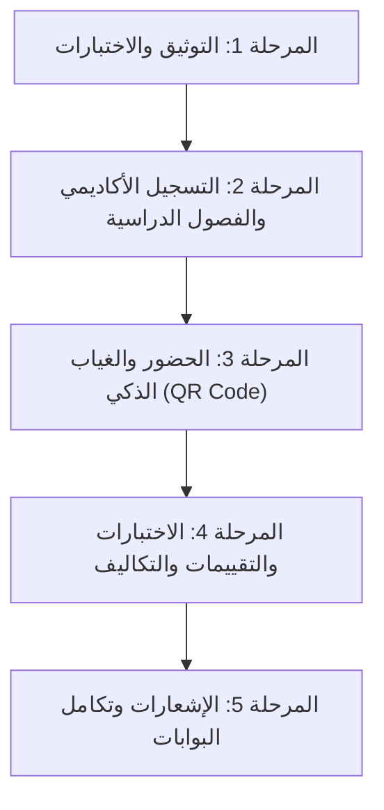

# **خطة توثيق وتطوير نظام StudySync (Implementation Plan)**

## **وصف الهدف (Goal Description)**
الهدف هو إعداد توثيق هندسي ومعماري شامل لمشروع **StudySync** في ملف `README.md` رئيسي وتأسيس خريطة طريق واضحة (Roadmap) للمراحل القادمة، مع تقديم جرد دقيق لكافة المكونات والميزات التي تم إنجازها بالفعل في النظام، ومواءمة الأولويات للمرحلة التالية من التطوير.

---

## **مراجعة المستخدم المطلوبة (User Review Required)**

> [!IMPORTANT]
> يرجى مراجعة خريطة الطريق (Roadmap) المقترحة للتحقق من أولويات المرحلة القادمة (مثل البدء بنظام التسجيل الأكاديمي والفصول الدراسية، أو الحضور والغياب، أو نظام الاختبارات والتكاليف).

> [!NOTE]
> مشروع StudySync مبني وفق أحدث المعايير الهندسية باستخدام **.NET 10.0** و **Clean Architecture** مع **CQRS** و **PostgreSQL**، ويحتوي حالياً على 49 اختباراً آلياً ناجحاً بنسبة 100%.

---

## **أسئلة مفتوحة للتأكيد (Open Questions)**
1. **لغة التوثيق الأساسية في المستودع**: هل تفضل أن يكون ملف `README.md` الرئيسي باللغة الإنجليزية بالكامل (مع ملخص عربي)، أم بالعربية والإنجليزية معاً؟
2. **أولوية الميزة القادمة**: بعد اكتمال التوثيق، هل نبدأ بتنفيذ **نظام التسجيل الأكاديمي والمقررات المطروحة (Course Offerings & Enrollments)** أم **نظام الحضور والغياب عبر QR Code (Lectures & Attendance)**؟

---

## **التغييرات المقترحة (Proposed Changes)**

### **1. توثيق المستودع (Repository Documentation)**
إنشاء ملف `README.md` في المجلد الرئيسي يوثق:
- نظرة عامة على النظام وأهدافه.
- المخطط المعماري ونمط Clean Architecture + CQRS.
- الميزات المكتملة بالتفصيل (المصادقة، الجلسات، المقررات، إدارة الأخطاء، البوابات المنفصلة).
- الحسابات الافتراضية للبيئة التجريبية (Doctor & Student seed credentials).
- كيفية تشغيل المشروع محلياً (Prerequisites, Database setup, EF Migrations, Run).
- كيفية تشغيل الاختبارات الآلية (49 Tests).
- دورة النشر المستمر (CI/CD Workflow to RunASP).

#### **[NEW] `README.md` (في المجلد الجذري للمشروع)**
يتضمن الدليل التقني الشامل ثنائي اللغة وروابط التوثيق والـ Endpoints.

---

### **2. خريطة الطريق التقنية للمراحل القادمة (Feature Roadmap)**



---

## **خطة التحقق والاعتماد (Verification Plan)**

### **الاختبارات المؤتمتة (Automated Tests)**
- تشغيل كافة الاختبارات الحالية للتأكد من سلامة البناء:
  ```powershell
  dotnet test
  ```
- التأكد من اجتياز 49 اختباراً بدون أي أخطاء.

### **التحقق اليدوي (Manual Verification)**
- التحقق من تنسيق الـ Markdown وصحة روابط المسارات والأوامر في `README.md`.
- مراجعة Swagger UI والتأكد من توافق التوثيق مع الـ Endpoints الفعلية.
